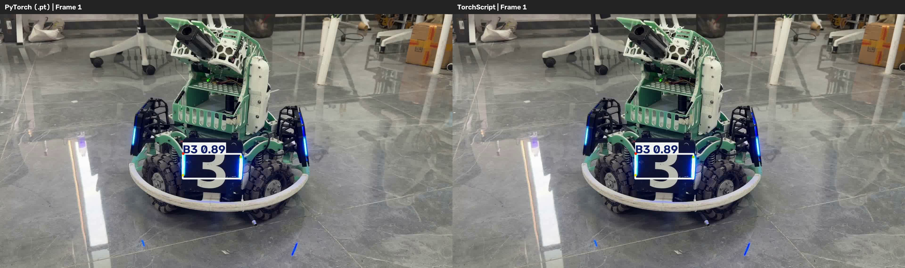
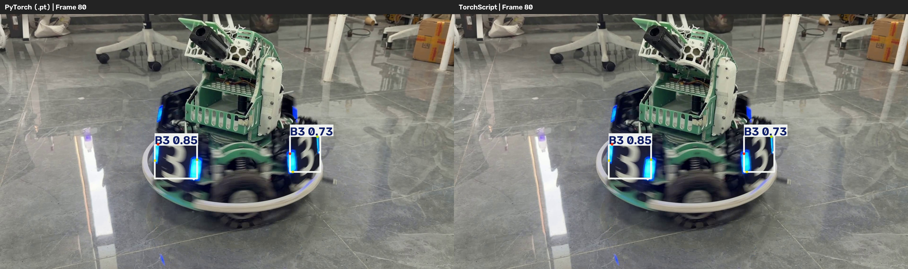
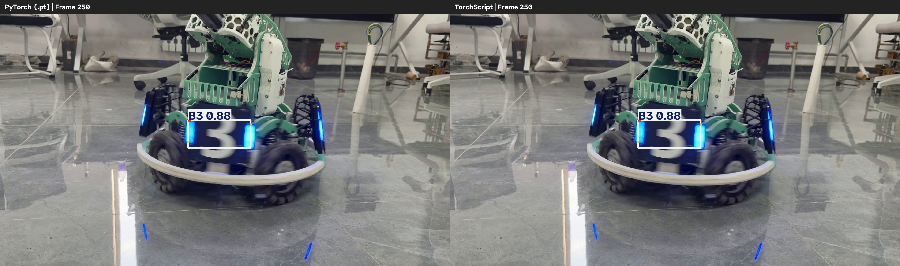

# YOLO 模型导出、推理与性能对比

## 1. 项目介绍

本项目沿用上一次作业中的装甲板模型 best.pt 和原始测试视频，
将 PyTorch 模型导出为 TorchScript 格式，并分别使用两种格式
完成视频推理，比较模型文件大小、预测耗时和检测效果。

本项目不重新训练模型。

## 2. 模型与测试数据

- 模型结构：YOLO26n-pose。
- 原始模型：models/best.pt。
- 导出模型：models/best.torchscript。
- 检测类别：B1、B2、B3、R1、R2、R3。
- 关键点：每个检测目标预测 4 个二维关键点。
- 测试视频：data/Robot_test.mp4，沿用上一次作业的原始视频。
- 视频总帧数：本次两种模型均处理了 505 帧。

## 3. 已完成的实验

1. 将原始 .pt 模型导出为 TorchScript 格式。
2. 使用两种模型分别处理同一视频，保存带检测标注的结果。
3. 在 CPU 上统一输入尺寸和推理参数，预热后重复测量预测耗时。
4. 保存第 1、80、250 帧的左右对比图片。
5. 保存测速汇总表和每次测量的原始数据。

## 4. 运行环境与实验设置

### 软件环境

| 项目 | 版本或说明 |
|---|---|
| 操作系统 | Windows |
| CPU | AMD Ryzen 9 9955HX 16-Core Processor |
| Python | 3.11.17 |
| PyTorch | 2.14.1+cu132 |
| Ultralytics | 8.4.183 |
| Python 环境 | Conda 环境 yolo |
| 本次推理和测速设备 | CPU |

虽然当前 PyTorch 环境支持 GPU，但本次两种模型均明确使用
device="cpu"，因此本报告中的速度结果属于 CPU 测试结果。

### 两种模型的统一推理参数

| 参数 | 设置 | 含义 |
|---|---|---|
| imgsz | 640 | 输入尺寸 |
| rect | False | 使用 640×640 输入，不启用最小矩形填充 |
| conf | 0.35 | 检测置信度阈值 |
| iou | 0.70 | NMS 的 IoU 阈值 |
| max_det | 300 | 每帧最多保留的检测数量 |
| batch | 1 | 每次处理一帧 |
| device | cpu | 使用 CPU 推理 |
| half | False | 不使用 FP16 半精度 |

两种格式使用同一份权重来源、同一个原始视频，
并在同一台电脑、同一软件环境下运行。

## 5. 运行方法

运行前，在项目根目录打开终端，并使用已安装所需依赖的 Python 环境。
模型放在 models/best.pt，原始视频放在 data/Robot_test.mp4。

### 5.1 导出模型

```bash
python export.py
```

生成 models/best.torchscript，保留原始 best.pt。

### 5.2 使用 TorchScript 模型推理

```bash
python inference.py
```

检测结果视频和逐帧标签保存在 results/torchscript。

### 5.3 使用原始 PyTorch 模型推理

```bash
python inference_pt.py
```

检测结果视频和逐帧标签保存在 results/pt。

### 5.4 测试模型大小和预测耗时

```bash
python benchmark.py
```

生成：

- results/benchmark_summary.csv：模型大小和耗时汇总。
- results/benchmark_raw.csv：每一次测量的原始记录。

### 5.5 生成同帧对比图片

先完成两种模型的视频推理，再执行：

```bash
python compare_images.py
```

第 1、80、250 帧的左右对比图片保存在 results/comparison。

### 本机 PowerShell 运行示例

如果终端尚未激活 yolo 环境，可直接指定解释器：

```powershell
& "F:\Anaconda\envs\yolo\python.exe" export.py
```

其他脚本同样替换最后的文件名即可。
该解释器路径仅适用于本机，其他电脑应使用自己的 Python 环境路径。

## 6. 测速方法

从原始视频中均匀抽取 30 帧，并提前读取到内存中。
两种模型使用完全相同的测试画面和推理参数。

每种模型先预热 10 次，再正式测试 3 轮，每轮处理 30 帧，
因此每种模型共记录 90 次耗时。各轮交替模型的测试顺序，
减小固定先后顺序带来的影响。

使用 time.perf_counter() 测量一次 model.predict() 调用的耗时。
计时包含预处理、模型执行及后处理，不包含视频读取、
检测结果绘制和视频保存，也不包含模型加载和预热。

本实验统计平均值、中位数和标准差：

- 平均值：全部测量耗时的平均水平。
- 中位数：排序后位于中间的耗时。
- 标准差：衡量耗时的波动程度。

原始测量记录保存在 results/benchmark_raw.csv。

## 7. 实验结果

| 对比项目 | PyTorch | TorchScript |
|---|---:|---:|
| 文件格式 | .pt | .torchscript |
| 文件大小 | 5.62 MiB | 9.94 MiB |
| 平均预测耗时 | 15.77 ms/帧 | 18.74 ms/帧 |
| 中位数耗时 | 15.27 ms/帧 | 18.17 ms/帧 |
| 耗时标准差 | 1.60 ms | 1.90 ms |
| 正式计时次数 | 90 | 90 |
| 全视频处理帧数 | 505 | 505 |
| 全视频逐帧检测数量之和 | 714 | 714 |
| 结果目录 | results/pt | results/torchscript |

文件大小采用 MiB，1 MiB = 1024 × 1024 字节。
表格中的数值经过四舍五入，完整记录见测速 CSV 文件。

逐帧检测数量之和会重复计算不同帧中出现的同一装甲板，
不代表视频中存在 714 个独立目标。

## 8. 检测效果对比

以下图片左侧为原始 PyTorch 模型，右侧为 TorchScript 模型。
图片从两份结果视频的相同帧提取，没有手工修改检测标注。

### 第 1 帧



### 第 80 帧



第 80 帧中，两种模型均检测到两个 B3 装甲板，
显示的置信度分别为 0.85 和 0.73，检测框位置在图中基本一致。

### 第 250 帧



全视频检测总数量相同，以及部分画面视觉上接近，
只能说明这些方面具有一致性，不能证明每个预测数值完全相同。

本实验没有使用人工标注的测试集计算 mAP，
因此不据此声称两种格式的检测准确率完全相同。

## 9. 差异分析与结论

### 9.1 模型大小

本次导出的 TorchScript 文件约为原始文件的 1.77 倍。

模型导出并不等于模型压缩。两种格式保存模型的方式不同，
文件大小可能受到参数精度、计算图及附加信息等因素影响。
本次使用 FP32 导出，没有进行量化压缩。

上述因素是可能原因，本实验没有进一步拆解文件，
因此不能将大小变化归因于某一个已确认的因素。

### 9.2 预测耗时

本次 CPU 测试中，TorchScript 平均耗时比原始模型增加约 18.8%。

转换格式不保证在所有设备和环境中都能加速。
执行后端、算子实现、图优化和运行时开销都可能影响性能。
本次计时还包含预处理和后处理，不能解释为纯神经网络计算耗时。

本结论仅适用于当前电脑、软件版本、输入尺寸和测试数据，
不能直接推广到其他硬件、GPU 或其他模型。

### 9.3 检测效果

两种模型均完成 505 帧视频推理，逐帧检测数量之和均为 714。
第 80 帧中可见的类别、置信度显示值及检测框位置基本一致，
说明导出后的模型在本次测试中能够正常完成检测。

### 9.4 对模型格式的理解

- PyTorch .pt：本项目原始模型的保存形式，
  加载时需要兼容的模型代码和运行环境。
- TorchScript：保存可执行的模型计算表示及参数，
  本项目通过 Ultralytics 接口加载并完成推理。

本次完成了从模型导出、加载、推理到性能比较的完整流程。
实验表明，模型格式是否适合部署需要实际测量，
不能只根据文件扩展名判断性能。

## 10. 遇到的问题与解决方法

### 10.1 系统 Python 找不到 Ultralytics

原因：终端使用的是系统 Python，
而 YOLO 配置在另一个 Conda 环境中。

解决：使用 yolo 环境的 Python，
并在 PyCharm 中选择对应的解释器。

### 10.2 加载模型提示找不到 Pose26

原因：原先使用的 Ultralytics 8.3.163 中没有模型所需的 Pose26 类。

解决：将该环境中的 Ultralytics 更新为 8.4.183，
补充缺少的依赖后，原始 best.pt 成功加载。

### 10.3 更新后缺少依赖

更新时使用 --no-deps，随后检查发现缺少
nvidia-ml-py、polars 和 ultralytics-platform。

解决：安装缺失依赖，并使用 python -m pip check 检查依赖关系。

### 10.4 TorchScript 与 half 参数出现弃用警告

运行日志提示相关接口未来可能调整或移除。
本次所记录的环境仍然可以成功导出、加载和推理。

保留当前环境版本记录，未来升级环境时需要重新验证兼容性。

### 10.5 转换后文件变大、速度变慢

这不代表导出失败。导出模型已经完成实际推理，
文件大小与速度作为真实实验结果记录，并在差异分析中讨论。

## 11. 项目结构

    10.18work/
    ├── README.md
    ├── export.py
    ├── inference.py
    ├── inference_pt.py
    ├── benchmark.py
    ├── compare_images.py
    ├── models/
    │   ├── best.pt
    │   └── best.torchscript
    ├── data/
    │   └── Robot_test.mp4
    └── results/
        ├── pt/
        ├── torchscript/
        ├── comparison/
        │   ├── frame_001.jpg
        │   ├── frame_080.jpg
        │   └── frame_250.jpg
        ├── benchmark_summary.csv
        └── benchmark_raw.csv